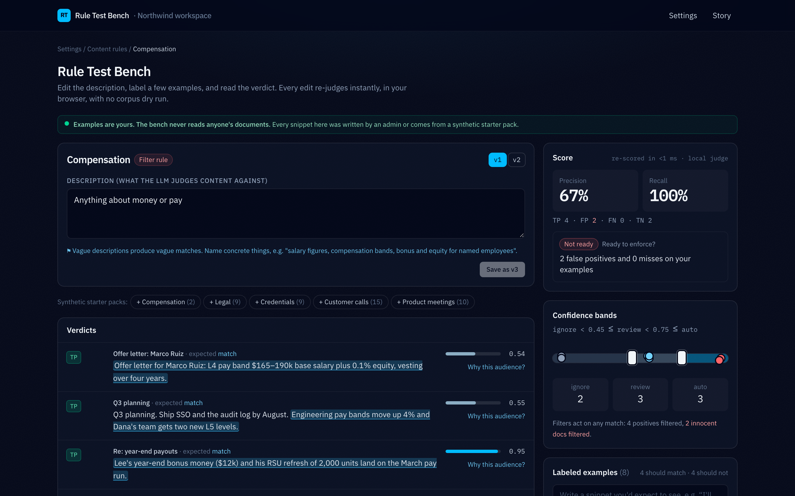
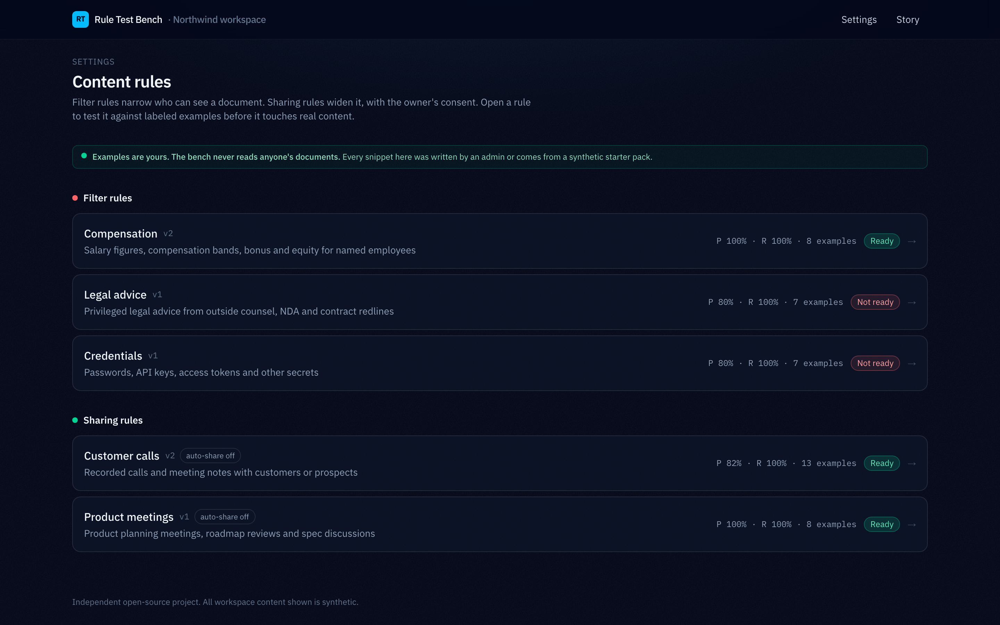
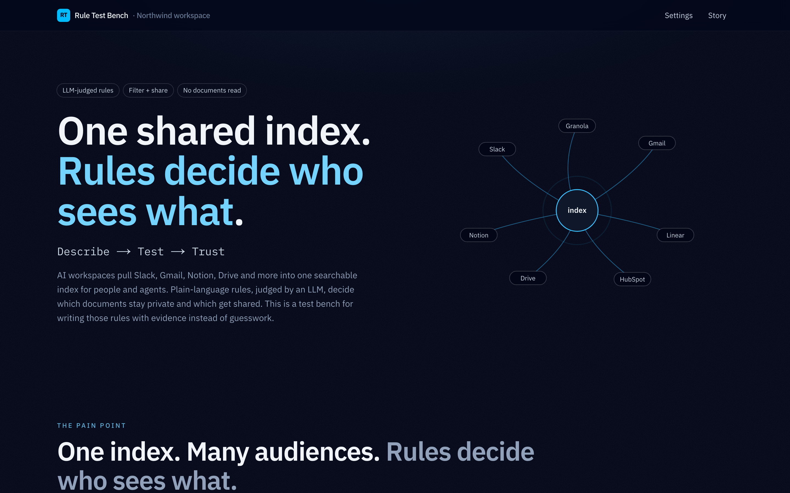

# Rule Test Bench

> Test a content rule against a handful of labeled example snippets and get the verdict instantly:
> precision, recall, the sentence that triggered each match, where every confidence lands on the
> auto / review / ignore bands, who ends up seeing each document, and whether a sharing rule is ready
> for auto-share. No corpus dry run, and nobody's documents are read.





*An independent open-source project. All people, documents and rules are synthetic.*

## The problem

AI workspace tools now pull a company's Slack, Gmail, Notion, Drive and call notes into one searchable
index that people and agents query. Once everything sits in one place, the hard question is **who may see
what**. A common answer is LLM-judged **content rules**: plain-language descriptions that a model checks
against every document. Filter rules narrow a document's audience and sharing rules widen it.

Those rules are easy to write and hard to trust:

- **Vague descriptions produce vague matches.** "Anything about money or pay" also catches a charity fun
  run and a vendor invoice, and one matching chunk is enough to hide a whole document.
- **Admins write blind.** For good privacy reasons the rule editor never shows anyone's documents, so there
  is nothing to check a description against.
- **Feedback is slow.** Checking a rule usually means a dry run over the stored corpus: an estimate, a
  confirmation, and a background job per edit. Users of popular tools in this space report slow preview loops
  and over-broad filters that quietly hide harmless documents.
- **Auto-share is a leap of faith.** New sharing rules start with auto-share off, and admins have no evidence
  for when it is safe to turn on.

## Why this feature

Two ideas were on the table. A *query provenance inspector* (why was a source missing from an answer?) helps
developers debug retrieval. A *rule test bench* helps the admins who make the access decisions that break or
build trust. The bench won because it fixes the root cause (rules you cannot test), keeps the guarantee that
nobody sees private content (examples are written by the admin), and gives a concrete readiness signal for
auto-share.

## Measured impact (seed data, computed by `lib/score.ts`)

| | Before | After |
|---|---|---|
| Compensation filter precision (8 labeled examples) | 67% (v1, "Anything about money or pay") | 100% (v2, "Salary figures, compensation bands, bonus and equity for named employees"), recall stays 100% |
| False positives | 2 (fun run, Figma invoice) | 0 |
| Feedback per edit | a corpus dry run | ~1 ms re-score in the browser (120 ms debounce) |
| Customer-calls sharing rule | v1: 1 false share, keep auto-share off | v2: 7 of 9 auto-share, 2 to owner Inbox, 0 false shares, ready |

## What it does

- **Score**: TP / FP / FN / TN, precision and recall over your examples, re-computed on every keystroke
  (120 ms debounce, judged in the browser).
- **Bands**: each example's confidence on the auto / review / ignore strip, with draggable thresholds and
  live counts. Filters act on any non-ignore band; sharing rules auto-share or ask the owner.
- **Audience explainer**: "Why this audience?" traces connection defaults ∪ sharing rules ∩ filter rules
  for one example, step by step, with rule versions and confidences.
- **Readiness + diff**: "7 of 9 positives would auto-share, 2 go to the owner's Inbox, 0 false shares →
  Ready to enable auto-share", and "v2 fixed 2 false positives, lost 0 true positives".

Plus synthetic starter packs, versioned descriptions (v1, v2, Save as v3), per-viewer drafts in
`localStorage`, and a Flaky judge toggle that shows sharing failing closed.

## How rules are judged here

```ts
interface RuleJudge {
  judge(rule: RuleVersion, snippet: Example, neighbors?: Example[]): Promise<Judgement>;
}
```

- **LocalJudge** (default, deterministic): per sentence,
  `s = 0.6 · conceptOverlap + 0.4 · (maxSim(should-match) − maxSim(should-not-match))`, then a logistic
  curve to a confidence. Concept overlap expands description terms through a small lexicon
  (`lib/judge/lexicon.ts`). "money" and "pay" deliberately map only to themselves, which is why v1 over-matches.
- **LlmJudge** (optional): Claude (`claude-opus-5-5`) with a structured JSON verdict through `@anthropic-ai/sdk`.
  Only used when `RULE_JUDGE=llm` and `ANTHROPIC_API_KEY` are set; any failure becomes a `JudgeError`.
- **FlakyJudge**: fails every Nth call to demonstrate fail-closed sharing.

In production this interface would map to a server-side classifier (for example a Python/FastAPI service) behind
`POST /rules/{id}/test { description, examples }`. `app/api/judge/route.ts` is that seam: it judges only the
examples in the request body.

## Audience algebra

```
final = ∪ default audience of each connection      shared → Everyone, personal → owner
        ∪ sharing rules (if an owner opted in)      auto → Everyone, review → owner's Inbox card
        ∩ filter rules (only if wider than 1 owner) match removes Everyone; shared-only → Nobody,
                                                    personal → owners. Filter beats share: no Inbox card.
judge error: sharing fails closed (no widening); ingest filters fail open (warning shown)
```

Implemented as a pure function in `lib/audience.ts` with a test per row of the audience truth table.

## Run it

```bash
pnpm i
pnpm dev                 # http://localhost:3000 → /settings/rules, /settings/rules/compensation, /story
pnpm test                # Vitest: 90 unit/integration tests
pnpm typecheck && pnpm lint && pnpm build
PORT=4102 pnpm e2e       # Playwright against the production build
```

Optional: copy `.env.example` to `.env.local` and set `RULE_JUDGE=llm` plus `ANTHROPIC_API_KEY` to have the
`/api/judge` endpoint use Claude. The bench UI always works offline with the LocalJudge.

## Stack

**Next.js 15 (App Router) + React 19 + TypeScript (strict)**, **Tailwind CSS v4**,
**IBM Plex**, `motion` (framer-motion) for the story page, **Vitest** + **Playwright**, pnpm. No database: seed
data lives in TypeScript modules.

```
app/settings/rules/            rule list (filters | sharing) with live readiness chips
app/settings/rules/[id]/       the Test Bench
app/story/                     animated explainer (what the brag video shows)
app/api/judge/route.ts         POST {ruleVersion, examples} → judgements
components/bench/*             RuleEditor, ExampleList, ResultsGrid, ThresholdBands, ScoreCard,
                               VersionDiff, AudienceExplainer, StarterPacks, PrivacyNote
lib/judge/*                    RuleJudge interface, LocalJudge, LlmJudge, FlakyJudge, lexicon, text
lib/{bands,audience,score,diff,bench}.ts   pure core logic (tests first)
lib/seed/*                     Northwind org, rules, ~45 synthetic examples, starter packs
tests/                         Vitest + tests/e2e Playwright
```

## Seed data

Northwind is fictional: Priya, Marco, Dana and Lee; shared Notion / Linear / Drive; personal Gmail, Granola
and Slack DMs. Every snippet is invented (keys like `AKIA…` and `sk_live_…` are placeholders). The privacy test
(`tests/privacy.test.ts`) checks that no route handler imports example content and no code fetches a documents API.

## Limits and next steps

- Per-team audiences would add a third set to the algebra.
- Sync bench examples into the production dry run, so a rule ships with its own regression set.
- Keep an eval history per rule version and show drift as new examples arrive.
- The LocalJudge is lexical. It is there to make the workflow tangible, not to replace the real classifier.

Built with [Claude Code](https://claude.com/claude-code).
